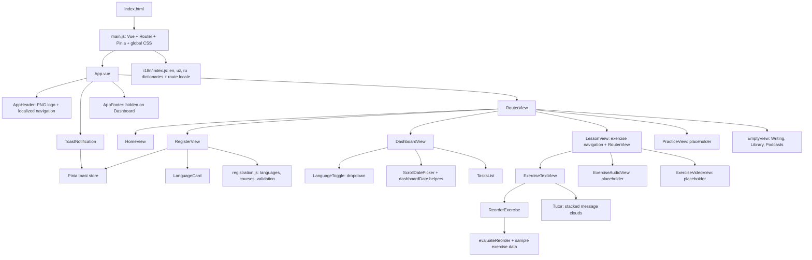

# LingoLaab

LingoLaab is currently a **frontend-only language-learning demo**, built with Vue 3, Vue Router, Pinia, and Vite. It includes localized registration, a sample task dashboard, and an interactive German word-order exercise with scripted tutor feedback.

There is no backend, database, authentication, AI API, payment integration, or saved learning progress. Registration does not create an account. This README describes the current implementation, updated on 22 October 2026.

## Run locally

Install Node.js and npm, then run from the repository root:

```sh
cd frontend
npm ci
npm run dev
```

Open the URL Vite prints (normally `http://localhost:5173`).

```sh
npm run build    # Production files in frontend/dist
npm run preview  # Preview the production build locally
```

The repository does not pin a Node version. The locked Vite 5 package requires Node `^18.0.0 || >=20.0.0`; use a maintained compatible runtime. There are no environment variables or database setup steps. `package-lock.json` records exact dependency versions. There is no root `package.json`.

## Architecture



Views are lazy-loaded Vue single-file components. Page state uses Vue refs and reactive objects; Pinia holds only temporary toast notifications. Global design tokens and shared styles live in `src/assets/main.css`.

## Repository structure

```text
.gitignore
README.md
netlify.toml                   # Single deployment configuration
 docs/color-palette.md         # Three preserved palettes and semantic roles
frontend/
  index.html                   # Entry shell; PNG favicon
  package.json
  package-lock.json
  vite.config.js               # Vue plugin; development port 5173
  src/
    App.vue
    main.js
    assets/
      full_logo.png            # Shared header/footer logo and favicon
      main.css
    router/index.js
    i18n/index.js              # Dictionaries and locale helpers
    stores/toast.js
    data/
      registration.js
      reorderExercise.js
    utils/
      dashboardDate.js
      reorderExercise.js
    components/
      AppHeader.vue
      AppFooter.vue
      ToastNotification.vue
      dashboard/
        LanguageToggle.vue
        ScrollDatePicker.vue
        TasksList.vue
      exercises/
        ReorderExercise.vue
        Tutor.vue
      registration/
        LanguageCard.vue
    views/
      HomeView.vue
      DashboardView.vue
      RegisterView.vue
      LessonView.vue
      ExerciseTextView.vue
      ExerciseAudioView.vue
      ExerciseVideoView.vue
      PracticeView.vue
      EmptyView.vue
```

`node_modules/`, `dist/`, generated outputs, logs, local overrides, and environment files are ignored. There is no backend directory until an actual backend is implemented.

## Routes and localization

| Route | Behavior |
| --- | --- |
| `/` | Welcome message and a static 25% platform-development progress bar |
| `/register` | Four-step registration demo |
| `/dashboard` | Date-filtered sample tasks |
| `/exercises` | Redirect to `/exercises/text` |
| `/exercises/text` | Interactive word-order exercise |
| `/exercises/audio` | Audio exercise placeholder |
| `/exercises/video` | Video exercise placeholder |
| `/practice` | Practice placeholder |
| `/writing`, `/library`, `/podcasts` | Empty views reserved for those sections |

Every route also accepts `/uz` or `/ru` before its path, such as `/uz/register`, `/ru/dashboard`, `/uz/exercises/text`, and `/ru/`. Unprefixed pages use English. These routes share the same components; there are no separate platform copies.

Selecting Uzbek or Russian during registration updates the URL and interface immediately while retaining wizard state. The locale follows navigation and sets the HTML `lang`. Interface dictionaries are in `src/i18n/index.js`; flags and native-language sentences are in registration data. German word tiles and English translation prompts are sample learning content, separate from interface translations. Translations need native-speaker editorial review before release.

Vue Router uses browser history and restores scroll positions or scrolls to the top. There are no authentication guards or dedicated 404 view. The former mock login and legacy `/lesson` redirect have been removed.

## Header and Home

The full PNG logo links to Home. Navigation order: Exercises, Practice, Dashboard, Writing, Library, Podcasts, Registration. The header has responsive mobile navigation, active-link styling, Escape dismissal, and focus indicators.

Home displays a fixed 25% progress bar followed by a welcome message inviting visitors to explore the header sections. The bar is not a request-loading indicator or learner-progress calculation. The footer contains the current logo, a mailto link for team@lingolaab.de, and non-linked placeholders for Instagram, TikTok, YouTube, Facebook, Twitter, and Hugging Face. Social destinations are not configured yet. The footer is hidden on Dashboard.

## Registration

1. **First language:** Uzbek and Russian are enabled. Tajik, Kyrgyz, Kazakh, Turkmen, Persian, Turkish, Arabic, Ukrainian, Twi, Swahili, Yoruba, and Romanian are disabled and marked coming soon. Each card includes a flag and a mother-tongue sentence in that language.
2. **Learning language:** German is enabled. English, Chinese, Arabic, Spanish, Japanese, Turkish, French, Korean, Persian, Russian, Portuguese, Italian, and Malay are coming soon. Both language steps use `LanguageCard.vue`.
3. **Course:** A1.1–A1.2, A2.1–A2.2, B1.1–B1.2, B2.1–B2.3, and C1.1–C1.3. Hints explain self-selection; there is no placement test.
4. **Personal details:** email, name, password, sex, and age. Validation requires a nonblank name, a simple email format, at least eight password characters, a sex option (including other or prefer not to say), and an integer age from 1 to 120.

Finish validates, clears form values, opens the localized Dashboard, and shows a bottom toast explaining that this was a demo registration and no account or personal data was saved or sent. The toast disappears after 10 seconds. A new toast supersedes an older one without being dismissed by the older timer.

## Dashboard

German is selected in the language dropdown; English is disabled. Year, month, and day controls have increase buttons above and decrease buttons below. The minimum is **1 October 2026** and the maximum is **today plus one calendar year**, using the browser's local date and refreshing the limit every minute. Date helpers clamp short months and leap years.

The left sidebar lists Courses, Vocabulary, Library, Writing, Live-lessons, and Speaking club. These controls and the Accomplished tasks button currently have no click action.

Local fixtures provide three tasks for the page's initial today and two completed examples for yesterday; other dates show an empty state. Rows open the corresponding text, audio, or video exercise. Columns show task name, one to three earned stars (zero means unrated), and a read-only checkbox-shaped completion indicator. Exercise attempts do not update these sample results.

## Text exercise and Tutor

`LessonView` provides rounded horizontal exercise-type links and a nested route outlet. `ExerciseTextView` places `ReorderExercise` on the left (60%) and `Tutor` on the right (40%), stacking on small screens.

Three German sentences are defined in `data/reorderExercise.js`. Click word-bank tiles in order; click answer tiles to return them. Check compares the complete token sequence to the fixed answer. Matching positions use lime-green success colors and mismatches use vermillion error colors. Sentence status text also communicates the result. Missing words count as incorrect; alternative valid translations are not recognized.

Tutor begins with instructions. Every Check appends feedback based on whether all, some, or no sentences are correct. Clouds stack chronologically, and editing clears answer highlights without removing tutor messages. Feedback is scripted, with no AI calls. Exercise data, evaluation, and tutor presentation are separated for future database/API integration.

## State and persistence

- Registration form values exist only in the registration component and are cleared on completion.
- Dashboard selection and sample results are local to Dashboard.
- Answers and tutor history last only while the text view is mounted.
- Toasts are held temporarily in Pinia so they survive route navigation.
- Language persists through the URL only.

There are no application cookies, localStorage, sessionStorage, API requests, saved passwords, or database writes. Reloading resets in-memory state. There is no real identity, authorization, learner profile, or account session.

## Color palette and assets

The three preserved palettes, hex values, tokens, intended roles, and dark-mode limitations are documented in **[docs/color-palette.md](docs/color-palette.md)**. Palette variables remain in `main.css`, including dark-mode tokens for future use; there is currently no theme toggle.

`full_logo.png` is the only logo asset. Google Fonts supplies Plus Jakarta Sans and Outfit through a CSS import, with system-font fallbacks. Flags are emoji and vary by platform.

## Deployment

**Netlify is the configured target. A live site URL, domain, hosting account, production branch, or latest deployed commit has not been verified.** The inspected checkout's Git remote is `https://github.com/ezso/lingolaab`.

The root `netlify.toml` is the single configuration:

- Build base: `frontend`
- Build command: `npm run build`
- Published directory: `dist`, relative to the base (`frontend/dist`)
- SPA rewrite: `/*` → `/index.html` with status 200, enabling direct visits and refreshes on localized/nested routes

Deploy the repository using this root configuration. There are no Netlify functions, containers, backend services, or CI workflows in the repository. Confirm the connected project's settings and deployment status in Netlify before treating any site as current.

## Verification and limits

The production build and focused checks for date bounds/calendar changes, registration validation, locale routing, answer evaluation, and toast dismissal have passed during development. There is no committed automated test runner, lint/type-check setup, or browser test suite. A full browser/accessibility review remains outstanding.

Practice, audio, video, writing, library, and podcasts remain placeholders. Dashboard task data is illustrative; tutor feedback is deterministic. No AI, database, payments, real authentication, or saved progress is implemented. No software license file has been provided.
